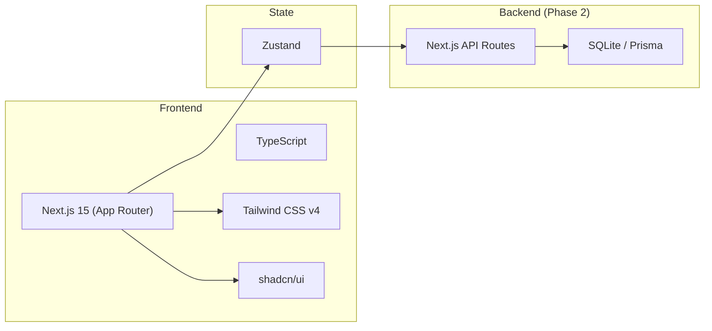
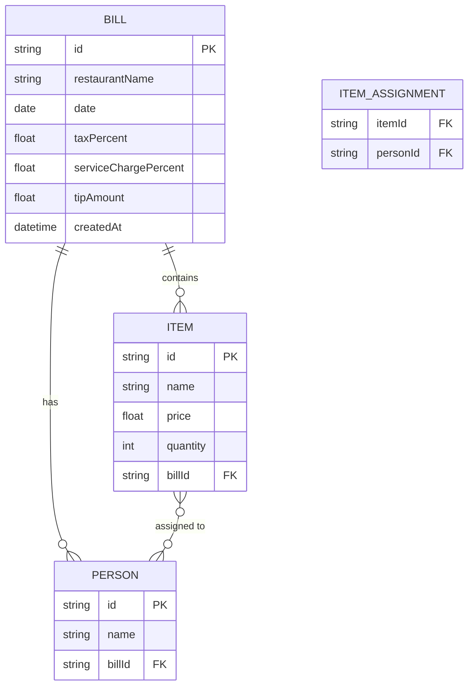
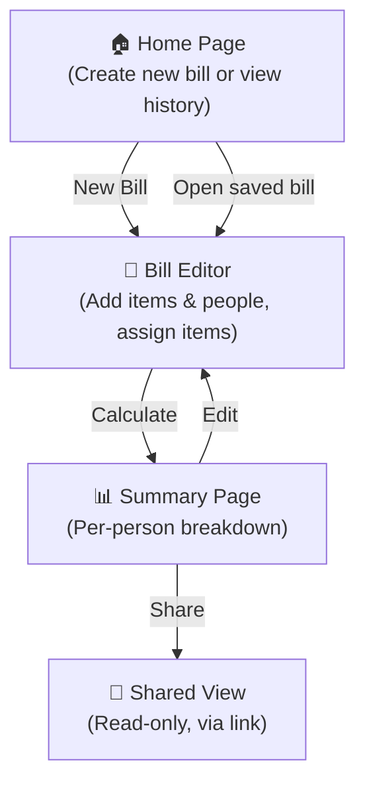

# 🧾 Goose Plus — Bill Splitting Web App

## Development Plan

---

## 1. Product Overview

**Goose Plus** is a web app that helps groups of people split restaurant bills fairly. Users can input bill items, assign them to specific people, and instantly see how much each person owes — including tax, service charge, and tip.

---

## 2. Core Features

### MVP (Phase 1)
| # | Feature | Description |
|---|---------|-------------|
| 1 | **Create a bill** | Enter restaurant name, date, and total amount |
| 2 | **Add people** | Add names of people splitting the bill |
| 3 | **Add bill items** | Enter each menu item with its price |
| 4 | **Assign items to people** | Tag each item to one or more people (shared items split evenly among tagged people) |
| 5 | **Shared costs** | Tax, service charge, and tip distributed proportionally based on each person's subtotal |
| 6 | **Summary view** | Clear breakdown showing each person's total with itemized details |
| 7 | **Quick equal split** | Option to just split the entire bill equally |

### Nice-to-Have (Phase 2)
| # | Feature | Description |
|---|---------|-------------|
| 8 | **Share via link** | Generate a shareable link so others can view the split |
| 9 | **Receipt OCR scan** | Upload a photo of the receipt to auto-extract items |
| 10 | **Payment QR codes** | Generate PromptPay / bank QR codes for easy payment |
| 11 | **History** | Save past bills (local storage or account-based) |
| 12 | **Multi-currency** | Support different currencies with formatting |

---

## 3. Tech Stack



| Layer | Technology | Why |
|-------|-----------|-----|
| **Framework** | Next.js 15 (App Router) | Full-stack React, great DX, easy deployment |
| **Language** | TypeScript | Type safety across the entire app |
| **Styling** | Tailwind CSS v4 + shadcn/ui | Rapid UI development, beautiful components |
| **State** | Zustand | Lightweight, simple state management |
| **Storage (MVP)** | LocalStorage | No backend needed for MVP — bills persist on device |
| **Storage (Phase 2)** | SQLite + Prisma | Lightweight DB for shareable bills |
| **Deployment** | Vercel | Zero-config Next.js hosting |

---

## 4. Data Model



### Calculated Fields (derived, not stored)
- **Person subtotal** = sum of `(item.price × item.quantity) / number_of_people_sharing_that_item`
- **Person's share of tax** = `person_subtotal / bill_subtotal × total_tax`
- **Person's share of service charge** = same proportional logic
- **Person's share of tip** = same proportional logic
- **Person total** = subtotal + tax share + service share + tip share

---

## 5. UI / Page Structure



### Key Screens

#### 1. Home Page (`/`)
- Hero with app name & tagline
- "New Bill" button (primary CTA)
- Recent bills list (from localStorage)

#### 2. Bill Editor (`/bill/[id]`)
- **Header section**: Restaurant name, date
- **People section**: Add/remove people (name chips)
- **Items section**: Add items with name, price, quantity
- **Assignment matrix**: For each item, tap which people share it
- **Extras section**: Tax %, service charge %, tip amount
- **"Calculate" button** → navigates to summary

#### 3. Summary (`/bill/[id]/summary`)
- Card per person showing:
  - Their items (and share of shared items)
  - Subtotal
  - + Tax share
  - + Service charge share
  - + Tip share
  - **= Total to pay**
- Grand total at bottom (sanity check)
- Share button & copy link

---

## 6. Implementation Plan

### Phase 1 — MVP (Target: ~3-4 days)

| Day | Tasks | Deliverable |
|-----|-------|-------------|
| **Day 1** | Project setup (Next.js, Tailwind, shadcn/ui, Zustand). Build data model types. Build Home page skeleton. | Running app with navigation |
| **Day 2** | Build Bill Editor: people management, item management, assignment UI (checkbox grid). | Functional bill editor |
| **Day 3** | Build calculation engine (proportional splitting logic). Build Summary page with per-person cards. LocalStorage persistence. | Working end-to-end flow |
| **Day 4** | Polish UI/UX, mobile responsiveness, error handling, edge cases (0 items, unassigned items). | Shippable MVP |

### Phase 2 — Enhancements (Optional)

| Task | Effort |
|------|--------|
| Share via link (API route + DB) | 1-2 days |
| Receipt OCR (Gemini Vision API) | 1-2 days |
| PromptPay QR generation | 0.5 day |
| PWA (offline support, installable) | 0.5 day |

---

## 7. Project Structure

```
Goose-plus/
├── src/
│   ├── app/
│   │   ├── layout.tsx              # Root layout
│   │   ├── page.tsx                # Home page
│   │   ├── bill/
│   │   │   └── [id]/
│   │   │       ├── page.tsx        # Bill editor
│   │   │       └── summary/
│   │   │           └── page.tsx    # Summary view
│   │   └── globals.css
│   ├── components/
│   │   ├── ui/                     # shadcn/ui components
│   │   ├── bill-editor/
│   │   │   ├── people-section.tsx
│   │   │   ├── items-section.tsx
│   │   │   ├── assignment-matrix.tsx
│   │   │   └── extras-section.tsx
│   │   ├── summary/
│   │   │   ├── person-card.tsx
│   │   │   └── grand-total.tsx
│   │   └── shared/
│   │       ├── header.tsx
│   │       └── empty-state.tsx
│   ├── lib/
│   │   ├── types.ts                # TypeScript interfaces
│   │   ├── calculator.ts           # Bill splitting logic
│   │   ├── storage.ts              # LocalStorage helpers
│   │   └── utils.ts                # General utilities
│   └── store/
│       └── bill-store.ts           # Zustand store
├── public/
├── package.json
├── tsconfig.json
├── tailwind.config.ts
└── next.config.ts
```

---

## 8. Key Algorithm — Proportional Split

```
For each person P:
  subtotal_P = 0
  
  For each item I assigned to P:
    share = (I.price × I.quantity) / count(people assigned to I)
    subtotal_P += share
  
  bill_subtotal = sum of all (item.price × item.quantity)
  ratio_P = subtotal_P / bill_subtotal
  
  tax_P = bill_total_tax × ratio_P
  service_P = bill_total_service × ratio_P  
  tip_P = bill_total_tip × ratio_P
  
  total_P = subtotal_P + tax_P + service_P + tip_P
```

> [!IMPORTANT]
> Rounding strategy: Round each person's total to 2 decimal places. Assign any rounding remainder (±0.01) to the last person to ensure the grand total matches exactly.

---

## 9. Design Decisions ✅

| # | Question | Decision |
|---|----------|----------|
| 1 | **Currency** | THB (฿) as default |
| 2 | **Identity** | Name-based, no accounts — users just type their name |
| 3 | **Design style** | Minimal / clean |

